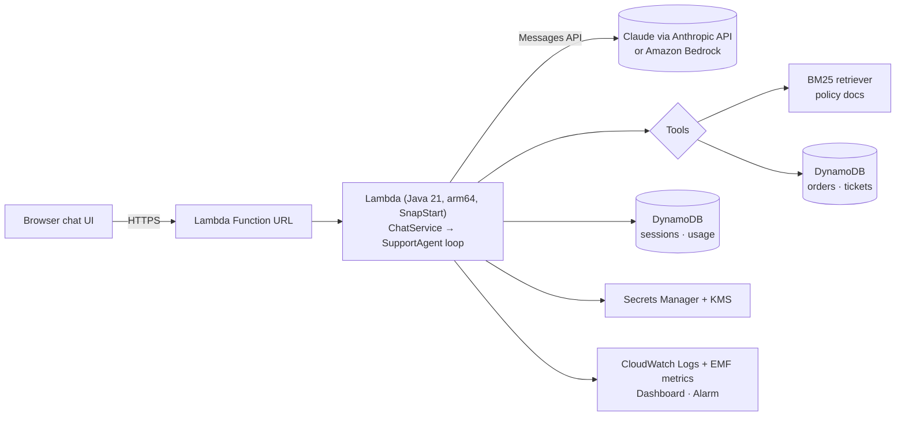

# Agentic Support Agent (Java 21 · AWS · Claude)

A small but **production-shaped** AI agent: a customer-support assistant for a fictional outdoor-gear store ("Summit Gear") that can look up orders, answer policy questions from a knowledge base, issue refunds under business rules, and escalate to humans. Small enough to read in an afternoon, complete enough to show every layer of a real agent system.



## What it demonstrates

| Concept | Where |
|---|---|
| Agent loop (tool calling, step budget, parallel tool results) | [`SupportAgent.java`](agent/src/main/java/dev/setugarg/supportagent/agent/SupportAgent.java) |
| Provider abstraction (Anthropic API ⇄ Bedrock with one env var) | [`llm/`](agent/src/main/java/dev/setugarg/supportagent/llm) |
| Tools with authorization + business rules in code, not prompts | [`Tools.java`](agent/src/main/java/dev/setugarg/supportagent/tools/Tools.java) |
| RAG retrieval (contextual chunking + BM25) | [`KnowledgeBase.java`](agent/src/main/java/dev/setugarg/supportagent/rag/KnowledgeBase.java) |
| Human-in-the-loop (refunds > $100 need approval), idempotency | `RequestRefund` in `Tools.java` |
| Short-term memory (DynamoDB, TTL, sliding window) | [`DynamoStores.java`](agent/src/main/java/dev/setugarg/supportagent/store/DynamoStores.java) |
| Prompt caching, effort control, refusal fallback | [`AnthropicLlmClient.java`](agent/src/main/java/dev/setugarg/supportagent/llm/AnthropicLlmClient.java) |
| Cost controls: step budget, max tokens, daily cap, reserved concurrency | `ChatService.java`, `SupportAgentStack.java` |
| Observability: structured logs, EMF metrics, dashboard, alarm, per-turn trace | [`Telemetry.java`](agent/src/main/java/dev/setugarg/supportagent/obs/Telemetry.java) |
| Evals: golden set, state-based graders, LLM-as-judge, model comparison, retrieval recall | [`evals/`](evals) |
| Infrastructure as code (CDK in Java) | [`SupportAgentStack.java`](infra/src/main/java/dev/setugarg/supportagent/infra/SupportAgentStack.java) |

## Documentation (read in order if you are new to this)

0. [Start here: what an AI agent actually is](docs/00-start-here.md)
1. [Architecture walkthrough: one request, end to end](docs/01-architecture.md)
2. [Every component, the commercial alternatives, and trade-offs](docs/02-components-and-tradeoffs.md)
3. [Glossary: the vocabulary you should know](docs/03-glossary.md)
4. [Evals: how we know it works](docs/04-evals.md)
5. [Inference: tokens, latency, cost, caching, hosting](docs/05-inference.md)
6. [Security and guardrails](docs/06-security-and-guardrails.md)
7. [Running it in production](docs/07-production-operations.md)
8. [Design review guide: FAQ and key numbers](docs/08-design-review-guide.md)
9. [Deploy it yourself, step by step](docs/09-deploy-step-by-step.md)

## Quick start

```bash
# build + unit tests (no API key needed)
mvn -q install

# run locally with in-memory data: open http://localhost:8080
ANTHROPIC_API_KEY=sk-ant-... java -jar agent/target/agent-lambda.jar

# free retrieval eval
mvn -q -pl evals exec:java -Dexec.args="--retrieval-only"

# full eval, comparing two models (costs a few dollars)
mvn -q -pl evals exec:java -Dexec.args="--models claude-opus-5-5,claude-haiku-5-5"

# deploy to AWS (see docs/09 for the one-time setup)
cd infra && npx aws-cdk deploy
```

## Repository layout

```
agent/    runtime: LLM clients, agent loop, tools, RAG, stores, Lambda handler, local server, chat UI
evals/    offline eval harness + golden datasets (cases/*.jsonl) + reports
infra/    AWS CDK app (Java) - DynamoDB, Lambda, Function URL, Secrets Manager, KMS, CloudWatch
docs/     the learning material
```

## Honest limitations

This is a demo, so some production pieces are simulated or simplified: the "signed-in customer" is picked from a dropdown (in production it would come from a verified identity token), the knowledge base is six markdown files, and the demo is protected by a shared access code instead of real auth. [docs/07](docs/07-production-operations.md) lists what you would add next and why.
