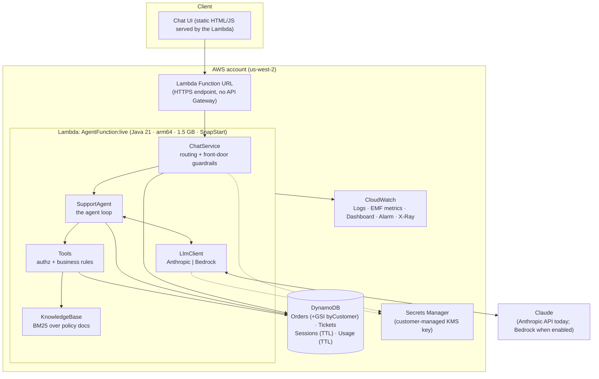
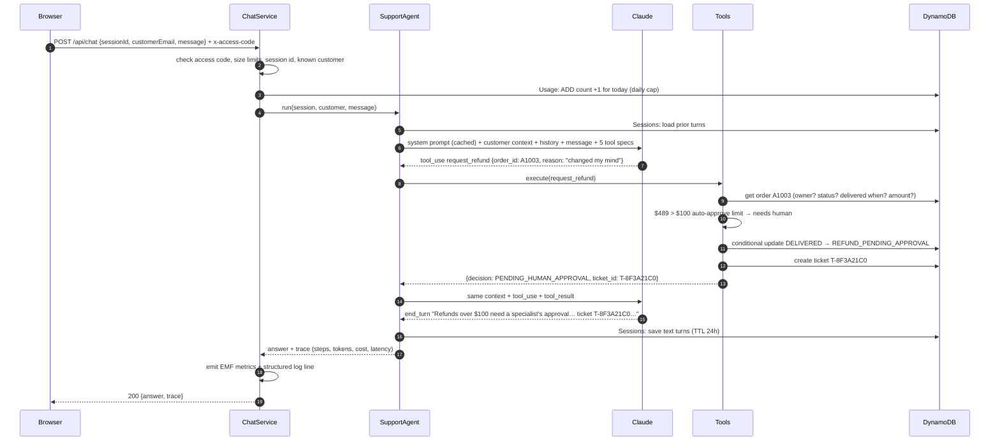

# 01 · Architecture: one request, end to end

## Components at a glance

## The life of one message

Say Maya types: **"Please refund my tent order A1003, I changed my mind."**

Things to notice (these are the talking points):

* **Steps 2-3 happen before a single token is spent.** Cheap checks go first: reject bad input, unknown users, or over-budget traffic at the door.
* **Step 6 sends the whole context again.** The model has no memory between calls; we resend the system prompt, tool definitions and history every time. The static part is **prompt-cached**, so repeat calls bill it at about 10% of the normal input price.
* **Steps 9-11 are the most important design decision in the system.** The model asked for a refund, but the *tool* decided it needs a human, using rules written in Java. A prompt-injected or confused model can't move money, because the rules don't live in the prompt.
* **Step 11 is a compare-and-set.** If the request is retried, or two tabs race, only one transition from `DELIVERED` succeeds. Agents retry a lot, so side-effecting tools must be idempotent.
* **Steps 7 and 13 are two model calls for one user message.** Agent latency = (model calls × model latency) + tool latency. Typical turns here are 1-3 model calls.

## Why each box exists

| Box | Responsibility | Key file |
|---|---|---|
| ChatService | HTTP routing, authentication (access code), input validation, daily cap, metrics | `api/ChatService.java` |
| SupportAgent | The loop: call model → run tools → repeat; step budget; memory load/save; trace | `agent/SupportAgent.java` |
| LlmClient | Translate our neutral message format to a provider's wire format; caching; retries | `llm/*.java` |
| Tools | The agent's capabilities. Each re-validates input and enforces authorization | `tools/Tools.java` |
| KnowledgeBase | Chunk docs by section, BM25 rank, return the top 3 with sources | `rag/KnowledgeBase.java` |
| Stores | Interfaces with DynamoDB and in-memory implementations (local/tests/evals) | `store/*.java` |
| Telemetry | JSON logs and CloudWatch EMF metrics (latency, tokens, cost, tool calls) | `obs/Telemetry.java` |
| Infra | Everything above, declared in CDK | `infra/.../SupportAgentStack.java` |

## Deployment topology and request limits

* **One Lambda function** behind a **Function URL**. The `live` alias points at the latest published version (SnapStart snapshots published versions).
* **Reserved concurrency = 10**: at most 10 conversations are processed at once. Excess requests get HTTP 429 from Lambda. This caps blast radius and spend.
* **Timeout 90 s**: a turn is several model calls; p95 is well under that.
* **Daily request cap (300)** enforced in DynamoDB: a spend circuit breaker that doesn't depend on anyone watching dashboards.

## Data model (DynamoDB)

| Table | Key | Notes |
|---|---|---|
| Orders | `orderId` | GSI `byCustomer` (`customerEmail`, `orderDate`) for "list my orders". Status transitions use condition expressions. PITR on. |
| Tickets | `customerEmail` + `ticketId` | Human escalations, including refund approvals. |
| Sessions | `sessionId` | Conversation text turns as JSON, `ttl` = 24 h. |
| Usage | `day` | Atomic counter (`ADD count :1`) for the daily cap, `ttl` = 7 days. |

Access patterns were designed first, then keys: that's how DynamoDB modelling works, and it's a good thing to say out loud.

## Local vs cloud: same code, different wiring

`App.fromEnv()` is the composition root. With `STORE=memory` (the default locally) it wires in-memory stores and reads `ANTHROPIC_API_KEY` from the environment. With `STORE=dynamo` (set by CDK) it wires DynamoDB and Secrets Manager. The agent, tools and prompt are identical, so what you test locally is what runs in production.
